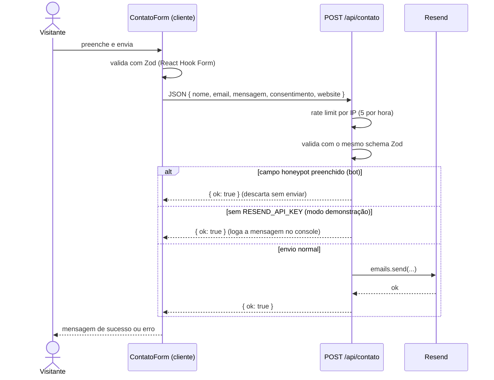

<h1 align="center">GPX7 · Landing Page</h1>

<p align="center">
  Landing page institucional da <b>GPX7</b>, empresa goiana de soluções audiovisuais para eventos corporativos.<br>
  Dark theme, conteúdo centralizado em um único arquivo e formulário de contato com envio de e-mail.
</p>

<p align="center">
  
  
  
  
  
  
</p>

<p align="center">
  
</p>

---

## 📋 Índice

- [Sobre o projeto](#-sobre-o-projeto)
- [Estado atual](#-estado-atual)
- [Seções da página](#-seções-da-página)
- [Tecnologias](#-tecnologias)
- [Arquitetura e decisões de projeto](#-arquitetura-e-decisões-de-projeto)
- [Estrutura de pastas](#-estrutura-de-pastas)
- [Design system](#-design-system)
- [Como editar o conteúdo](#-como-editar-o-conteúdo)
- [Formulário de contato e API](#-formulário-de-contato-e-api)
- [SEO e acessibilidade](#-seo-e-acessibilidade)
- [Como rodar](#-como-rodar)
- [Variáveis de ambiente](#-variáveis-de-ambiente)
- [Deploy](#-deploy)
- [Imagens](#-imagens)
- [Scripts utilitários](#-scripts-utilitários)
- [Pendências e próximos passos](#-pendências-e-próximos-passos)
- [Autor](#-autor)

---

## 📌 Sobre o projeto

A **GPX7** é uma empresa de Goiânia (GO), fundada em 2003, que fornece **vídeo, áudio, iluminação, informática e transmissão** para congressos, feiras, convenções e auditórios.

Este projeto é a landing page da empresa. O objetivo é apresentar a GPX7, mostrar as soluções e os eventos já atendidos e **converter visitantes em contatos comerciais**, por formulário, WhatsApp, telefone ou e-mail.

Principais características:

- **Single page** com navegação por âncoras e rolagem suave
- **Conteúdo desacoplado do layout**: todos os textos e dados ficam em `src/lib/content.ts`
- **Formulário de contato** com validação (Zod), proteção contra spam e envio por e-mail (Resend)
- **Responsivo** (mobile first), com tema escuro e identidade visual em laranja
- **Preparado para deploy na Vercel**

---

## 🚧 Estado atual

O projeto está **em desenvolvimento**. A estrutura e as seções principais já estão prontas, e faltam informações finais do cliente e ajustes de produção (veja [Pendências](#-pendências-e-próximos-passos)).

**Já implementado**
- [x] Tema escuro com design tokens e tipografia Inter
- [x] Header dinâmico (barra de contato rápido + navbar que muda ao rolar) e menu mobile
- [x] 9 seções + rodapé
- [x] Botão flutuante de WhatsApp
- [x] Formulário de contato com validação, consentimento LGPD, honeypot e rate limit
- [x] API de contato com envio de e-mail via Resend (com modo demonstração sem chave)
- [x] SEO básico: metadados, Open Graph, Twitter Card, `robots.txt` e `sitemap.xml`
- [x] Compatibilidade com deploy na Vercel

---

## 🧩 Seções da página

A página é montada em `src/app/page.tsx`, na ordem abaixo. A navegação do topo usa as âncoras da coluna **ID**.

| # | Seção | Componente | ID (âncora) | O que mostra |
|---|---|---|---|---|
| 1 | Hero | `Hero` | `#hero` | Imagem de fundo, título de impacto e botão "Fale com a GPX7" |
| 2 | Faixa de segmentos | `FaixaSegmentos` | — | Congressos / Feiras / Convenções / Auditórios / Transmissões |
| 3 | Quem somos | `QuemSomos` | `#quem-somos` | Apresentação e 3 números (ano de fundação, anos de experiência e estrutura própria) |
| 4 | Soluções | `Solucoes` | `#servicos` | 6 cards: vídeo e projeção, áudio, iluminação, informática, transmissão e operação técnica |
| 5 | Formatos | `Formatos` | — | 4 tipos de evento atendidos, em cards de foto |
| 6 | Processo | `Processo` | — | Projeto → Montagem → Operação → Suporte |
| 7 | Eventos atendidos | `Eventos` | `#portfolio` | Galeria com 6 eventos já realizados |
| 8 | Por que a GPX7 | `PorQueGpx7` | — | 4 diferenciais da empresa |
| 9 | Contato | `Contato` | `#contato` | Formulário e canais diretos (WhatsApp, telefone, e-mail, Instagram) |
| 10 | Rodapé | `Footer` | — | Copyright e (futuramente) link da política de privacidade |

Elementos fixos: `HeaderNav` (topo) e `WhatsAppButton` (canto inferior direito).

### Capturas de tela


<table>
  <tr>
    <td align="center"><b>Hero</b><br></td>
    <td align="center"><b>Quem somos</b><br></td>
  </tr>
  <tr>
    <td align="center"><b>Soluções</b><br></td>
    <td align="center"><b>Formatos</b><br></td>
  </tr>
  <tr>
    <td align="center"><b>Processo</b><br></td>
    <td align="center"><b>Eventos atendidos</b><br></td>
  </tr>
  <tr>
    <td align="center"><b>Por que a GPX7</b><br></td>
    <td align="center"><b>Contato</b><br></td>
  </tr>
</table>

### Header dinâmico

O header tem dois blocos que reagem à rolagem da página (gatilho: mais de 24 px):

| Estado | Barra de contato rápido | Navbar principal |
|---|---|---|
| **No topo** | Visível, com ícones de WhatsApp e Instagram e o e-mail | Transparente, sobre a imagem do Hero |
| **Rolando** | Recolhe com transição suave | Fundo escuro translúcido com `backdrop-blur` e sombra |

No mobile, a navbar vira um botão de menu (hambúrguer) que abre uma lista suspensa. O item **Contato** aparece destacado como botão em laranja.


<p align="center">
  
  
</p>

---

## 🛠️ Tecnologias

| Tecnologia | Versão | Uso |
|---|---|---|
| [Next.js](https://nextjs.org) (App Router) | 16.4 | Framework, roteamento, API Routes, otimização de imagens e fontes |
| [React](https://react.dev) | 19.3 | Interface |
| [TypeScript](https://www.typescriptlang.org) | 5 | Tipagem estática |
| [Tailwind CSS](https://tailwindcss.com) | 4 | Estilização (tokens definidos em `@theme`) |
| [React Hook Form](https://react-hook-form.com) | 7 | Gerenciamento do formulário |
| [Zod](https://zod.dev) | 4 | Validação (mesmo schema no cliente e no servidor) |
| [@hookform/resolvers](https://github.com/react-hook-form/resolvers) | 5 | Integração entre React Hook Form e Zod |
| [Resend](https://resend.com) | 6 | Envio dos e-mails do formulário |
| [lucide-react](https://lucide.dev) | 1.x | Ícones |
| ESLint (`eslint-config-next`) | 9 | Lint |

> O Next.js 16 exige **Node.js 20.9 ou superior**.

---

## 🏗️ Arquitetura e decisões de projeto

### Conteúdo como fonte única de verdade

Todo texto e dado do site (contatos, navegação, títulos, serviços, eventos, passos do processo) mora em **`src/lib/content.ts`**. Os componentes só renderizam esse objeto. Com isso, dá para alterar um telefone, um título ou um card de evento sem mexer em layout.

```
content.ts  ──►  componentes de seção  ──►  page.tsx
(dados)          (só renderizam)             (monta a página)
```

### Server Components por padrão

As seções são Server Components, que enviam HTML pronto e menos JavaScript para o navegador. Só usam `"use client"` os componentes que precisam de interatividade:

| Componente | Por que é Client Component |
|---|---|
| `HeaderNav` | Escuta o scroll e controla o menu mobile (`useState` / `useEffect`) |
| `ContatoForm` | Estado do formulário e envio com `fetch` |
| `WhatsAppButton` | Componente de interação do botão flutuante |

### Destaque em laranja nos títulos

Os títulos aceitam uma marcação simples: o trecho entre `**asteriscos**` vira texto na cor da marca. O componente `SectionTitle` faz essa conversão.

```ts
title: "Tecnologia, estrutura e **excelência** em cada detalhe."
//                              └─ renderizado em laranja
```

### Aliases de importação

O `tsconfig.json` define `@/*` apontando para `src/*`, então os imports ficam assim: `import { siteContent } from "@/lib/content"`.

---

## 📁 Estrutura de pastas

```
gpx7-landing/
├── docs/
│   └── screenshots/                 # Capturas de tela usadas neste README
├── public/
│   └── images/
│       ├── hero.jpg                 # Fundo do Hero
│       ├── cta-bg.jpg               # Fundo da seção de contato
│       ├── og-image.jpg             # Imagem de compartilhamento (Open Graph)
│       ├── logo-gpx7.png            # Logo com fundo transparente
│       ├── logo-gpx7-original.png   # Logo original
│       ├── formatos/                # Fotos da seção Formatos
│       └── eventos/                 # Fotos da seção Eventos atendidos
├── src/
│   ├── app/
│   │   ├── api/contato/route.ts     # Endpoint POST /api/contato
│   │   ├── layout.tsx               # Layout raiz: fonte Inter e metadados (SEO)
│   │   ├── page.tsx                 # Página única (monta as seções)
│   │   ├── globals.css              # Tailwind, design tokens e estilos base
│   │   ├── robots.ts                # robots.txt dinâmico
│   │   └── sitemap.ts               # sitemap.xml dinâmico
│   ├── components/
│   │   ├── sections/                # Uma seção da página por arquivo
│   │   ├── ui/                      # Componentes reutilizáveis (Button, Container...)
│   │   ├── HeaderNav.tsx            # Header dinâmico
│   │   ├── Footer.tsx
│   │   ├── ContatoForm.tsx          # Formulário de contato
│   │   └── WhatsAppButton.tsx       # Botão flutuante
│   └── lib/
│       ├── content.ts               # Todo o conteúdo do site
│       ├── schema.ts                # Schema Zod do formulário
│       └── rate-limit.ts            # Rate limiter em memória
├── .env.example                     # Modelo das variáveis de ambiente
├── next.config.ts
├── generate-placeholders.js         # Script: gera imagens placeholder
├── inspect-logo.js                  # Script: inspeciona as cores da logo
└── make-transparent-logo.js         # Script: gera a logo em texto/SVG
```

---

## 🎨 Design system

### Cores

Definidas em `src/app/globals.css`, dentro de `@theme`:

| Token | Valor | Uso |
|---|---|---|
| `--color-bg` | `#0B0F1C` | Fundo principal |
| `--color-bg-alt` | `#121830` | Fundo alternado das seções e cards |
| `--color-ink` | `#F4F6FB` | Texto principal |
| `--color-mute` | `#9AA3BC` | Texto secundário |
| `--color-brand` | `#E8501B` | Cor da marca (laranja): botões, destaques, ícones |
| `--color-hero-text` | `#C9CFE2` | Texto do Hero |
| `--color-line` | `rgb(255 255 255 / 0.12)` | Bordas e divisores |

### Tipografia e espaçamento

- **Fonte:** [Inter](https://rsms.me/inter/) (pesos 400, 500, 700 e 800), carregada com `next/font`
- **Títulos fluidos:** `h1` varia de 34 a 68 px e `h2` de 28 a 44 px (`clamp`)
- **Container:** largura máxima de 1080 px com 22 px de padding lateral
- **Espaço entre seções:** 76 px no desktop e 56 px no mobile (até 760 px de largura)

### Componentes de UI (`src/components/ui`)

| Componente | Função |
|---|---|
| `Container` | Centraliza o conteúdo na largura máxima |
| `Eyebrow` | Texto pequeno em maiúsculas acima dos títulos |
| `SectionTitle` | Título com suporte à marcação `**destaque**` |
| `Button` | Botão pílula laranja (variantes `primary` e `outline`). Vira link quando recebe `href` |
| `PhotoCard` | Card com foto, gradiente e legenda (proporção 4:3 ou 1:1) |

---

## ✏️ Como editar o conteúdo

Tudo fica em `src/lib/content.ts`.

**Trocar telefone, WhatsApp, e-mail e Instagram**

```ts
contact: {
  phone: "(62) 3200-0000",
  whatsapp: "https://wa.me/5562999999999",   // link wa.me com DDI + DDD + número
  whatsappDisplay: "(62) 99999-9999",         // número exibido na tela
  email: "contato@gpx7.com.br",
  instagram: "https://instagram.com/gpx7audiovisual",
  instagramDisplay: "@gpx7audiovisual",
  // ...
}
```

> Os valores atuais são **exemplos**. Troque pelos dados reais antes de publicar.

**Adicionar um evento na galeria**

1. Coloque a foto em `public/images/eventos/` (formato `.jpg`).
2. Adicione um item em `events.items`:

```ts
{
  id: "novo-evento",
  label: "Nome do Evento",
  image: "/images/eventos/novo-evento.jpg",
  alt: "Descrição da foto para acessibilidade",
},
```

**Adicionar um serviço:** inclua um item em `solutions.items`. O campo `icon` precisa ser um dos nomes mapeados em `Solucoes.tsx` (`Monitor`, `Mic`, `Lightbulb`, `Laptop`, `Radio` ou `Wrench`). Para usar outro ícone do [lucide](https://lucide.dev), adicione-o ao `iconMap` desse componente.

**Anos de experiência:** o valor é calculado automaticamente a partir de 2003 (`foundedYear`), então não precisa atualizar todo ano.

---

## 📬 Formulário de contato e API

### Fluxo de envio


### Regras de validação (`src/lib/schema.ts`)

| Campo | Regra | Mensagem de erro |
|---|---|---|
| `nome` | 2 a 100 caracteres | "Informe seu nome completo" |
| `email` | E-mail válido, até 150 caracteres | "Digite um e-mail válido" |
| `mensagem` | 10 a 1000 caracteres | "Escreva ao menos 10 caracteres" |
| `consentimento` | Precisa ser `true` (checkbox LGPD) | "É necessário concordar para continuar" |
| `website` | Honeypot: precisa ficar vazio | — |

### Proteções contra spam

- **Honeypot:** o campo `website` fica oculto para humanos. Se vier preenchido, a API responde `ok: true` sem enviar nada, para não dar pista ao bot.
- **Rate limit:** máximo de **5 requisições por IP a cada 1 hora**, em memória (`src/lib/rate-limit.ts`). Em ambiente serverless cada instância tem sua própria memória, então o limite funciona como "melhor esforço".

### Endpoint `POST /api/contato`

**Corpo da requisição**

```json
{
  "nome": "Maria Silva",
  "email": "maria@empresa.com.br",
  "mensagem": "Gostaria de um orçamento para um congresso em março.",
  "consentimento": true,
  "website": ""
}
```

**Respostas**

| Status | Quando | Corpo |
|---|---|---|
| `200` | Enviado com sucesso, honeypot acionado ou modo demonstração | `{ "ok": true }` |
| `400` | Corpo ausente ou inválido | `{ "ok": false, "error": "Dados inválidos", "details": { ... } }` |
| `429` | Limite de 5 envios por hora excedido | `{ "ok": false, "error": "Muitas tentativas. Aguarde antes de tentar novamente." }` |
| `500` | Falha do Resend ou erro interno | `{ "ok": false, "error": "..." }` |

**E-mail recebido pela empresa:** o assunto é `Novo contato pelo site — {nome}`, e o campo *Reply-To* é o e-mail do visitante, então basta responder diretamente.

**Testando com `curl`:**

```bash
curl -X POST http://localhost:3000/api/contato \
  -H "Content-Type: application/json" \
  -d '{"nome":"Maria Silva","email":"maria@empresa.com.br","mensagem":"Teste de contato pelo site.","consentimento":true,"website":""}'
```

### Modo demonstração

Se `RESEND_API_KEY` **não** estiver definida, a API não envia e-mail: ela registra a mensagem no console do servidor e responde `{ "ok": true, "message": "Mensagem recebida em modo demonstração." }`. Isso permite desenvolver e testar o formulário sem configurar o Resend.

---

## 🔍 SEO e acessibilidade

**SEO**
- `<html lang="pt-BR">`, título e descrição otimizados para "audiovisual para eventos em Goiânia"
- Open Graph e Twitter Card com imagem de compartilhamento (`og-image.jpg`, 1200×630)
- `robots.txt` e `sitemap.xml` gerados dinamicamente a partir de `NEXT_PUBLIC_SITE_URL`
- Imagens servidas pelo `next/image`

**Acessibilidade**
- Landmarks semânticos (`header`, `nav`, `main`, `section`, `footer`, `aside`)
- Rótulos `aria-label` em links de ícone e no menu mobile (`aria-expanded`)
- Formulário com `label` associado, `aria-invalid`, `aria-describedby` e erros com `role="alert"`
- Feedback de envio em região `aria-live`
- Respeita `prefers-reduced-motion` (desativa rolagem suave e animações)
- Foco visível nos botões

---

## 🚀 Como rodar

### Pré-requisitos

- [Node.js](https://nodejs.org) **20.9 ou superior**
- npm (ou outro gerenciador de pacotes)

### Passo a passo

```bash
# 1. Clonar o repositório
git clone https://github.com/Dioogooa/Gpx7-landingPage.git
cd Gpx7-landingPage

# 2. Instalar as dependências
npm install

# 3. Criar o arquivo de variáveis de ambiente
cp .env.example .env.local

# 4. Rodar em modo de desenvolvimento
npm run dev
```

Acesse **http://localhost:3000**.

Sem preencher o `.env.local`, o site funciona normalmente e o formulário opera em [modo demonstração](#modo-demonstração).

### Scripts disponíveis

| Comando | O que faz |
|---|---|
| `npm run dev` | Servidor de desenvolvimento |
| `npm run build` | Build de produção |
| `npm run start` | Serve o build de produção |
| `npm run lint` | Verifica o código com o ESLint |

---

## 🔐 Variáveis de ambiente

Copie `.env.example` para `.env.local` e preencha:

| Variável | Obrigatória | Descrição |
|---|---|---|
| `RESEND_API_KEY` | Para enviar e-mails | Chave da API do [Resend](https://resend.com). Se ficar vazia, o formulário roda em modo demonstração |
| `CONTACT_TO_EMAIL` | Não | E-mail que **recebe** os contatos. Padrão: `contato@gpx7.com.br` |
| `CONTACT_FROM_EMAIL` | Não | Remetente verificado no Resend (ex.: `contato@dominio.com.br`). Padrão: `onboarding@resend.dev` |
| `NEXT_PUBLIC_SITE_URL` | Não | URL pública do site, usada em metadados, `robots.txt` e `sitemap.xml`. Padrão: `https://www.gpx7.com.br` |

> O remetente `onboarding@resend.dev` é o de testes do Resend e tem restrições de envio. Para produção, [verifique o seu domínio no Resend](https://resend.com/docs/dashboard/domains/introduction) e use um e-mail dele em `CONTACT_FROM_EMAIL`.

O arquivo `.env.local` está no `.gitignore`, então suas chaves não vão para o repositório.

---

## ☁️ Deploy

O projeto está preparado para a **[Vercel](https://vercel.com)**:

1. Importe o repositório na Vercel (o framework Next.js é detectado automaticamente).
2. Em **Settings → Environment Variables**, cadastre as 4 variáveis da seção acima.
3. Faça o deploy.
4. Quando o domínio final estiver definido, atualize `NEXT_PUBLIC_SITE_URL` e o `siteUrl` em `content.ts`.

O cliente do Resend é inicializado de forma **lazy**, dentro da requisição. Assim o build não falha quando a chave ainda não existe no ambiente.

---

## 🖼️ Imagens

| Arquivo | Usado em |
|---|---|
| `public/images/hero.jpg` | Fundo do Hero |
| `public/images/cta-bg.jpg` | Fundo da seção de contato |
| `public/images/og-image.jpg` | Compartilhamento em redes sociais |
| `public/images/logo-gpx7.png` | Logo no header |
| `public/images/formatos/` | `congressos`, `salas-simultaneas`, `feiras` e `convencoes` |
| `public/images/eventos/` | `cirurgia-cardiovascular`, `ficomex`, `ficomex-arena`, `expopecas`, `fast-summit` e `hackathon-saude-digital` |

**Boas práticas adotadas**
- Nomes de arquivo em minúsculas e com hífen. Em Linux (Vercel) os nomes diferenciam maiúsculas de minúsculas, então use sempre `.jpg` em minúsculo, de forma consistente com os caminhos do `content.ts`.
- O `next/image` redimensiona e converte as imagens automaticamente.

---

## 🧰 Scripts utilitários

Scripts Node soltos na raiz, usados durante o desenvolvimento para gerar e inspecionar assets. Eles **não fazem parte do build** e usam a biblioteca [`sharp`](https://sharp.pixelplumbing.com) (que já acompanha o Next.js).

| Script | Função |
|---|---|
| `generate-placeholders.js` | Gera imagens placeholder em `public/images` |
| `inspect-logo.js` | Lista as cores predominantes da logo |
| `make-transparent-logo.js` | Gera uma versão da logo em texto, com fundo transparente |

```bash
node generate-placeholders.js
```

---

## ✅ Pendências e próximos passos

**Conteúdo e produção**
- [ ] Substituir os contatos de exemplo (telefone, WhatsApp, e-mail e Instagram) pelos dados reais
- [ ] Definir o domínio final e atualizar `siteUrl` / `NEXT_PUBLIC_SITE_URL`
- [ ] Configurar o Resend (chave de API e domínio verificado)
- [ ] Criar a página de Política de Privacidade e preencher `footer.privacyLink`
- [ ] Revisar textos e fotos finais com o cliente

**Performance**
- [ ] Comprimir as fotos maiores (várias passam de 700 KB, e algumas de 1 MB) antes do deploy final

**Segurança e robustez**
- [ ] Escapar o HTML dos campos do formulário no corpo do e-mail enviado pela API
- [ ] Trocar o rate limit em memória por uma solução persistente (Upstash Redis) ou adicionar um captcha (Cloudflare Turnstile)

**SEO e qualidade**
- [ ] Adicionar dados estruturados (JSON-LD) de empresa local
- [ ] Adicionar testes automatizados
- [ ] Remover configurações e scripts de placeholder que não são mais usados (ex.: `remotePatterns` no `next.config.ts`)

---

## 👨‍💻 Autor

**Diogo Oliveira**, estudante do 4º período na PUC Goiás.

[](https://github.com/Dioogooa)
[](https://www.linkedin.com/in/diogo-almeida-3676952b6/)
